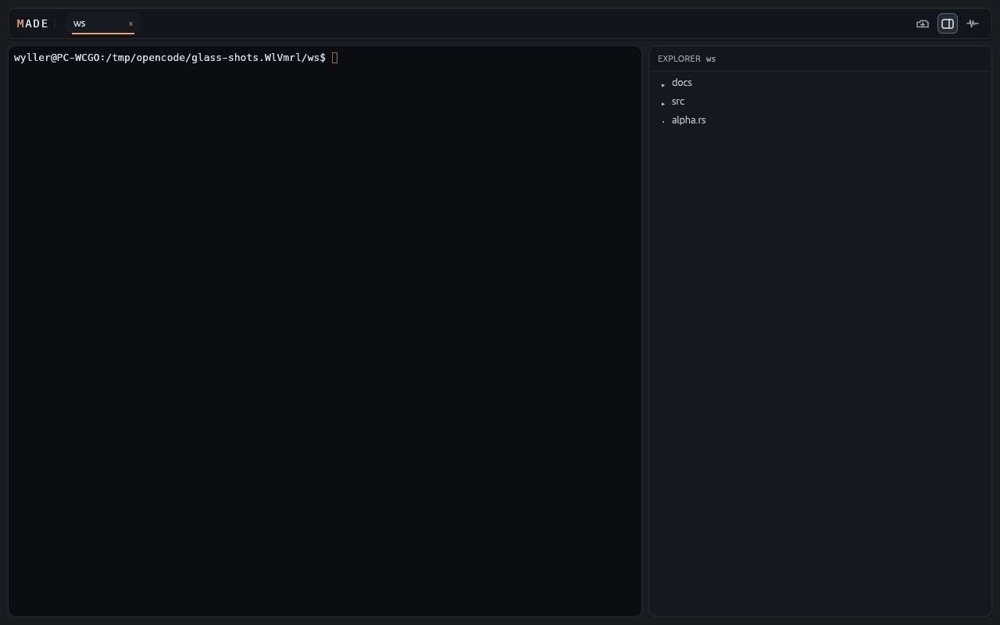

# Made

**Minimal Agentic Development Environment**

A native, terminal-first desktop workspace for developers: one window, independent live workspace tabs, and a real shell plus file explorer in every tab. Use it without an agent installed; when you launch OpenCode v2 in a tab, Made follows the active session and worktree.



## Why Made

- **Terminal-first, not agent-gated.** A shell and explorer open immediately. Made does not install, launch, probe, or wait for an agent.
- **Your workspace follows you.** `cd` in a supported shell and the explorer follows. If OpenCode v2 is running with an active session, that session's directory and worktree take precedence; disconnect returns to the shell cwd.
- **Independent tabs for real work.** Each workspace tab owns its own shell, process, explorer, preview, and focus. Close one without disturbing the others.
- **Native and fast.** Rust, `egui`, and a real PTY-backed terminal renderer. No webview.
- **Quiet by design.** Full-height explorer, full-left read-only preview, icon-only controls, and a glass UI that keeps the terminal readable.

## What you get

- **Independent live workspace tabs** — switch folders, keep every shell running, and close only what you mean to close.
- **Shell cwd follow** — launch-local bash, zsh, fish, and PowerShell hooks with spaces and Unicode support. Real bash is verified; other shell runs are pending.
- **Optional OpenCode session follow** — run `opencode` yourself in a tab; Made follows the active session directory and worktree when available.
- **Full-height explorer** — hide, restore, and pointer-resize it without stopping the shell.
- **Full-left read-only preview** — inspect a file over the still-running terminal, then return without relaunching anything.
- **Home startup and folder picker** — no argument opens your home workspace; `--picker` chooses a folder; an explicit path wins over both.
- **Diagnostics** — inspect workspace, cwd capability, effective root, integration state, logs, and metrics without routine status chrome.
- **Glass UI** — frosted-glass chrome and a full-height explorer, with optional macOS vibrancy or Windows 11 Mica behind the window. Linux and unsupported compositors use the in-app glass fallback.

## Quick start

### Prerequisites

- **Rust stable** via `rustup`.
- **Linux x64 on X11 or Wayland**, **macOS arm64/x64**, or **Windows x64**.
- **OpenCode v2** is optional. Install the native distribution for your OS if you want session follow. Made never launches it for you.
- **Node.js 24** is only needed for the OpenCode plugin tests.

### Build and run

```bash
cargo build -p made-app

# Open your home workspace
cargo run -p made-app

# Choose a folder
cargo run -p made-app -- --picker

# Open a specific workspace
cargo run -p made-app -- /path/to/project

# Disable the optional native window backdrop
MADE_NATIVE_BACKDROP=off cargo run -p made-app
```

On PowerShell, set `$env:MADE_NATIVE_BACKDROP="off"` before launching.

Start `opencode` inside a tab when you want agent session follow.

### Test

```bash
cargo test --workspace

cd plugins/opencode-made
npm ci
npm test
npm run typecheck
```

## Status

Made is a **v1 UX validation build**, not a production-ready release.

Linux automated and Xvfb checks verify the core workspace flows. Native Linux desktop, macOS, and Windows runs remain pending, as do real zsh/fish/PowerShell runs, native IME/clipboard/pointer behavior, hardware-GPU pacing, and CI artifacts. Native macOS vibrancy and Windows 11 Mica are compile-checked only; no native-effect runtime claim is made.

The file preview is read-only: no editing, saving, LSP, or diff view. Builds are unsigned; there are no installers, signing, notarization, or auto-update channels.

## Supported targets

- `aarch64-apple-darwin` — macOS arm64
- `x86_64-apple-darwin` — macOS x64
- `x86_64-unknown-linux-gnu` — Linux x64 on X11 and Wayland
- `x86_64-pc-windows-msvc` — Windows x64 with native OpenCode

## Documentation

- [Made wiki](wiki/index.md)
- [Core product spec](specs/changes/opencode-session-follow-v1/)
- [UI/UX spec](specs/changes/made-ui-ux-v1/)
- [End-to-end test checklist](tests/e2e/ux_validation.md)
