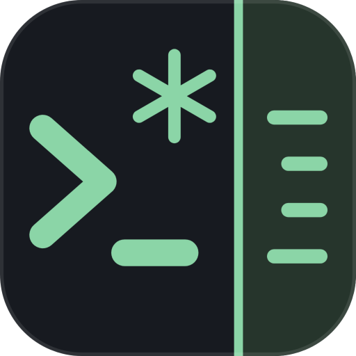

<p align="center">
  
</p>

<h1 align="center">MADE</h1>

<p align="center"><strong>Minimal Agentic Development Environment</strong></p>

Made is a native desktop workspace for working with coding agents in the terminal. Each tab opens a real shell and a file explorer straight away, on your machine or on an SSH server. Start OpenCode v2, Claude Code or Grok Build in a tab and Made follows the session: the explorer moves to the agent's working directory or worktree, and the tab shows the session's title and live status. If no agent is installed, Made works as a fast terminal with an explorer.

## Why Made

- **Terminal first, agents optional.** Each tab is a shell and an explorer. Made never installs, probes or waits for an agent, and never starts one on its own.
- **Follows the agent you already use.** OpenCode v2, Claude Code and Grok Build are integrated, with no lock-in. The explorer follows the active session's directory, including a worktree. The tab label shows the session title, and dots show whether each session is busy, idle or waiting for you.
- **One screen to open any workspace.** Pick Local or an SSH host, paste a path or browse to it, see the repository's worktrees and their pending changes, then launch a Terminal or any detected agent directly in that folder or worktree.
- **SSH works like local.** Remote browsing, git and worktree views, terminals and agent TUIs work the same as on your machine. Remote sessions survive a dropped connection and reattach.
- **Read-only and careful with your repositories.** Made never writes to git. Its git reads are hardened so that opening a repository never runs commands defined by that repository.
- **Native and quiet.** Built with Rust and `egui` on a PTY-backed terminal, with no webview. The calm dark design keeps the terminal in focus.

## Features

**Workspaces and tabs**
- Each tab runs its own shell, processes, explorer, preview and focus. Closing one tab leaves the others running.
- Shell tabs are named after the current folder and update when you `cd`. Agent tabs show the session title and fall back to the program name.
- A terminal or agent icon leads every tab. Session dots show busy (pulsing), idle and attention (yellow) states.
- Shell cwd follow uses launch-local hooks for bash, zsh, fish and PowerShell, with support for paths that contain spaces or Unicode.

**Open workspace screen** (the `+` button, `--picker`, or closing the last tab)
- A host bar lists Local first, then your saved SSH hosts with their connection state and the agents detected on each. You add, edit, test and remove hosts from the same bar.
- Folder navigation uses an expandable folder tree and an editable address bar. Paste an absolute path and press Enter to jump to it.
- A git indicator and a Worktrees list (main worktree first) show change counts split into conflicted, staged, modified and untracked.
- Launch buttons appear in a fixed order: Terminal first, then each detected agent (OpenCode, Grok Build, Claude Code). Cmd/Ctrl+Enter launches a Terminal.

**SSH remote workspaces**
- Made uses your installed OpenSSH, including your aliases, config, ProxyJump, keys or agent, and password or MFA prompts. Made never stores or logs credentials.
- When you connect to an unknown host, Made shows its OpenSSH fingerprint and waits for your approval. A changed host key is refused.
- The explorer, preview, git view and session follow run against the server. Remote shells and sessions reattach after the connection drops, until a 24-hour detached lease expires.

**Explorer, preview and git**
- The full-height explorer can be hidden, restored and resized while the shell keeps running.
- A read-only preview covers the terminal so you can inspect a file, then return to the same shell without relaunching anything.
- The source-control view is read-only, with grouped changes and change dots on files and folders.
- Every git read disables fsmonitor, protocol transports and lazy fetch. Filter drivers set by the repository are turned off for these reads.

**Everyday details**
- **Clipboard image paste:** Cmd/Ctrl+V forwards the paste so agent TUIs read the image natively. Cmd/Ctrl+Shift+V saves the image as a private PNG (kept 7 days, at most 64 files) and pastes its path as a fallback.
- **About and diagnostics:** open About from the MADE wordmark. It shows the version and update controls, and reveals workspace, integration, log and metric details when you ask.
- **Calm Editor design:** dark surfaces with one mint accent. macOS vibrancy or Windows 11 Acrylic (22H2, build 22621, or newer) is optional, and other systems fall back to in-app glass.
- **Self-updating releases:** installers and a Linux AppImage update in place from GitHub Releases. See [Updates](#updates).

## Install

Download Made from the [latest GitHub Release](https://github.com/wcgomes/made/releases/latest). Nothing else needs to be installed first; OpenCode, Grok Build, Claude Code, OpenSSH and git stay optional. Made installs for your user account only and never needs administrator rights.

| System | Download |
|---|---|
| Windows 10 (1809 or later) and Windows 11, x64 | `made-<version>-windows-x64-setup.exe` |
| macOS 12 or later, Apple silicon / Intel | `made-<version>-macos-arm64.pkg` / `made-<version>-macos-x64.pkg` (installer), or the `.zip` portable app |
| Linux x64 with glibc 2.35 or later (Ubuntu 22.04, Ubuntu 24.04, current Fedora) | `made-<version>-linux-x64.AppImage` |

Releases are not signed, so Windows SmartScreen and macOS Gatekeeper warn on first run. Open Made anyway for this app only, never by turning a protection off for the whole computer. The same warning can appear again after Made updates itself; the same steps apply.

- **Windows:** run the setup; at "Windows protected your PC" choose **More info**, then **Run anyway**. Made installs for your user, appears in the Start menu, and is removed from **Settings › Apps › Installed apps**.
- **macOS:** open the `.pkg` and choose **Install for me only**, or move the app from the `.zip` to the Applications folder in your home folder. On first open with macOS 15 or later, choose **Done**, then **System Settings › Privacy & Security › Open Anyway**, confirm **Open Anyway** and enter your login password. On macOS 12 to 14, Control-click Made, choose **Open**, then **Open**. The `.pkg` itself may need the same steps.
- **Linux:** mark the AppImage executable (file **Properties › Permissions**, or `chmod +x made-<version>-linux-x64.AppImage`) and double-click it. No FUSE package is needed.

### Updates

Made checks GitHub Releases at launch and once a day, downloads a newer release in the background and verifies it, then shows a small dot on the MADE wordmark. Open **About** and choose **Restart to update** when convenient; restarting closes every open workspace. To stop automatic checks, turn off **Check for updates automatically** in About; **Check for updates** still checks once when you ask. Builds run from source (`cargo run`) or development artifacts never update themselves. Because macOS builds are only ad-hoc signed, macOS may ask again for privacy permissions you granted Made (for example Files and Folders access) after an update; grant them again the same way.

Each release lists the SHA-256 of every file in `SHA256SUMS`. A matching digest shows a download is not corrupted; it does not prove who published it.

Maintainers: the bump-and-release procedure is in [`wiki/operations/release-ci.md`](wiki/operations/release-ci.md).

## Quick start

### Prerequisites

- **Rust stable** via `rustup`.
- **Linux x64 on X11 or Wayland**, **macOS arm64/x64**, or **Windows x64**.
- **OpenCode v2** is optional. Install the native distribution for your OS if you want OpenCode session follow. Made never launches it automatically; when `opencode` is on `PATH`, the Open workspace screen offers it as a launch button.
- **Grok Build**, **Claude Code**, **OpenSSH** and **git** are optional. The Open workspace screen shows a launch button for each agent it finds on the selected host; OpenSSH is needed only for SSH workspaces.
- **Node.js 24** is only needed for the OpenCode plugin tests; the Grok and Claude Code hooks are native and need no interpreter.

### Platform setup

Made is built natively on each supported OS; there is no supported cross-compilation step.

#### Linux (x64, X11 or Wayland)

The wgpu renderer and the PTY layer need X11/Wayland/EGL/Vulkan development packages before the first build.

```bash
sudo apt-get update
sudo apt-get install -y --no-install-recommends \
  libxkbcommon-dev \
  libwayland-dev \
  libx11-dev \
  libegl1-mesa-dev \
  libgl1-mesa-dev \
  libvulkan-dev
```

Other distributions need the equivalent X11/Wayland/EGL/Vulkan development packages.

Build with Rust from [rustup](https://rustup.rs); `rust-toolchain.toml` selects stable with clippy and rustfmt, and rustup installs that toolchain on first use.

**Native Linux:** a working X11 or Wayland session is required; `wgpu` selects a hardware Vulkan or GL adapter when one is available.

**WSL2 with WSLg:** install the same packages inside the distribution and the window opens on the Windows desktop. GPU support depends on the WSL version and its Vulkan stack, so a machine without a usable adapter falls back to software rendering with `LIBGL_ALWAYS_SOFTWARE=1`. WSL2 is a Linux host, not a native Linux desktop, and it does not stand in for the Windows build.

Releases are built on Ubuntu 22.04 and checked against a glibc 2.35 baseline; CI development artifacts are built on Ubuntu 24.04. Building on a newer distribution links a newer glibc than older targets can run.

#### macOS (arm64 or x64)

```bash
xcode-select --install
```

That provides the linker. Build with Rust from [rustup](https://rustup.rs); `rust-toolchain.toml` selects stable, which rustup installs on first use.

No extra system libraries are needed: Metal, CoreText, and the clipboard come from the OS.

#### Windows (x64)

Build the Windows target natively, or run the Linux build under WSL2 (see [Linux](#linux-x64-x11-or-wayland)). WSL2 is a Linux host and does not exercise the Windows-specific paths: ConPTY, Acrylic, native clipboard, and IME.

Install [Visual Studio Build Tools](https://visualstudio.microsoft.com/visual-cpp-build-tools/) with the **Desktop development with C++** workload; the MSVC linker is required because `x86_64-pc-windows-msvc` is the only supported Windows target.

Install Rust from [rustup](https://rustup.rs), then confirm the host toolchain and build:

```powershell
rustup show   # expect x86_64-pc-windows-msvc
cargo build -p made-app
```

The binary lands at `target\debug\made-app.exe`.

### Build and run

```bash
cargo build -p made-app

# Open your home workspace
cargo run -p made-app

# Start on the Open workspace screen
cargo run -p made-app -- --picker

# Open a specific workspace
cargo run -p made-app -- /path/to/project

# Disable the optional native window backdrop
MADE_NATIVE_BACKDROP=off cargo run -p made-app
```

On PowerShell, set `$env:MADE_NATIVE_BACKDROP="off"` before launching.

For agent session follow, start `opencode`, `claude` or `grok` inside a tab, or launch it from the Open workspace screen when it is on `PATH`.

### Test

```bash
cargo test --workspace

cd plugins/opencode-made
npm ci
npm test
npm run typecheck
```

## Status

Made is an early **0.1.x** release: installable and self-updating, but not production-ready.

Automated tests and smoke checks pass in CI across the supported targets, and release builds pass an installed-layout smoke on hosted runners. Interactive native desktop validation is still pending. That covers IME, clipboard and pointer behavior, hardware-GPU pacing, live OpenCode workflows, live SSH workspaces (including remote browsing and worktree views on the Open workspace screen), and fresh-machine installs of the packaged artifacts. Shell cwd follow is verified with real bash; zsh, fish and PowerShell have unit coverage only. Native macOS vibrancy was checked manually on arm64 only; macOS x64 and Windows 11 Acrylic (22H2+, build 22621) have not been validated interactively.

The file preview is read-only: no editing, saving, LSP, or diff view. Made does not create or manage worktrees. Releases are installable and update themselves, but they are not signed or notarized.

## Supported targets

- `aarch64-apple-darwin`: macOS arm64
- `x86_64-apple-darwin`: macOS x64
- `x86_64-unknown-linux-gnu`: Linux x64 on X11 and Wayland
- `x86_64-pc-windows-msvc`: Windows x64 with native OpenCode (ConPTY; WSL-hosted OpenCode is out of scope)

## Documentation

- [Made wiki](wiki/index.md)
- [Core product spec](specs/opencode-session-follow.md)
- [UI/UX spec](specs/made-ui-ux.md)
- [Agent integration architecture](specs/agent-integration-architecture.md)
- [SSH remote workspaces spec](specs/ssh-remote-workspaces.md)
- [Open workspace redesign (active change)](specs/changes/20261127-open-workspace-redesign/spec.md)
- [Release and auto-update spec](specs/release-distribution.md)
- [UX validation checklist (v1)](tests/e2e/ux_validation.md)
- [Release acceptance record](tests/e2e/release_validation.md)
