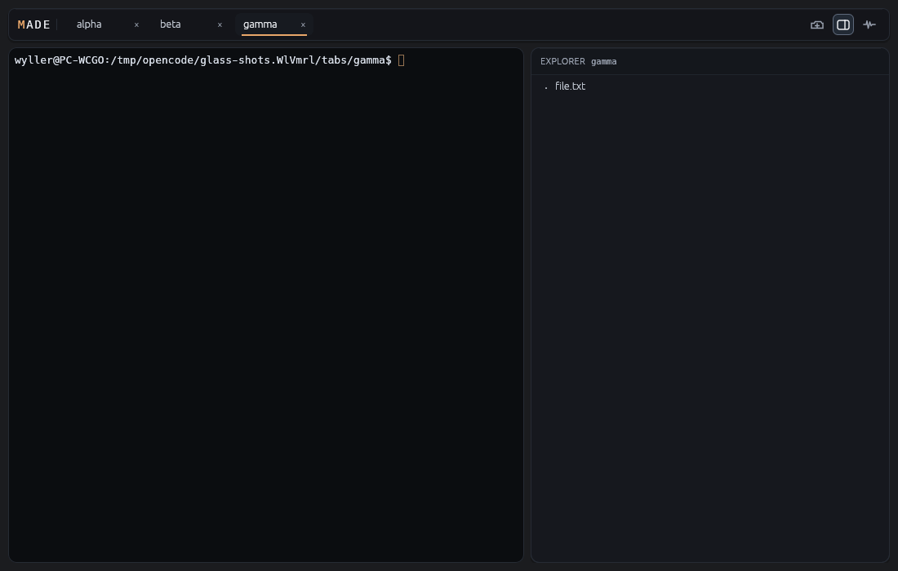
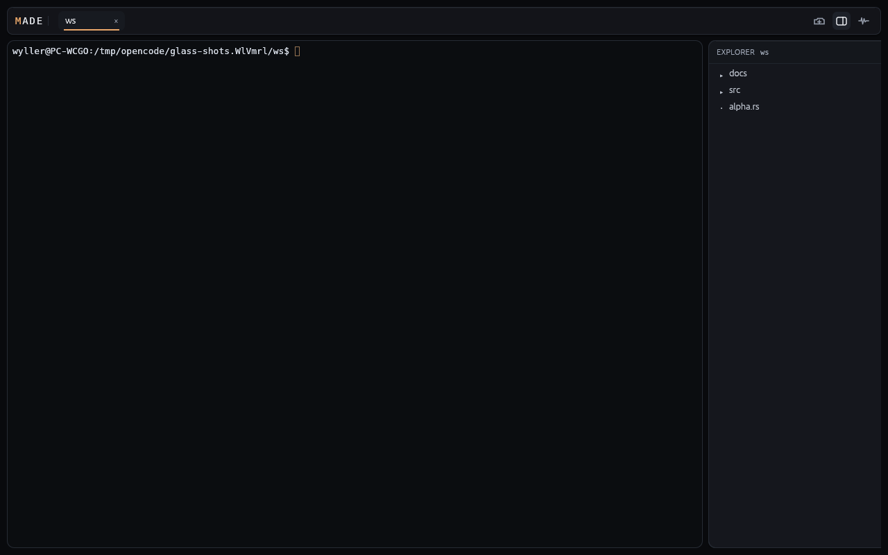
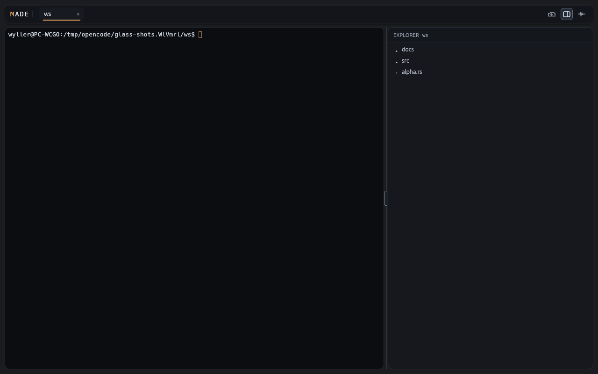
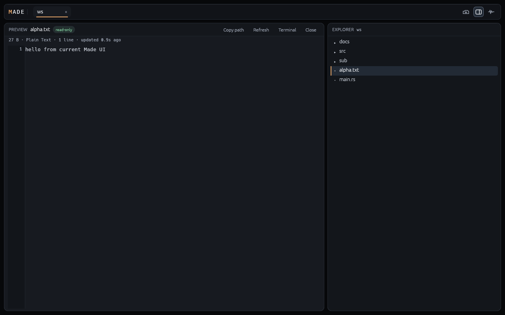
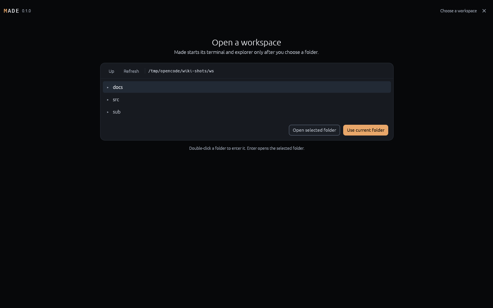

# Layout and Controls

Made uses one native window with workspace tabs above a content area, a selected left surface (terminal or full-left preview), and a full-height Explorer in the right column. The normative layout and interaction contract is [`specs/changes/made-ui-ux-v1/spec.md`](../../specs/changes/made-ui-ux-v1/spec.md). This page maps the implemented composition in [`ui.rs`](../../crates/made-app/src/ui.rs) and [`explorer_view.rs`](../../crates/made-app/src/explorer_view.rs).

## Window geometry

| Region | 1280×800 | 720×480 |
|---|---|---|
| Window gutter | 10 | 8 |
| Top workspace strip | 1260×40 at `(10,10)` | 704×36 at `(8,8)` |
| Gap below strip | 8 | 6 |
| Main content | 1260×732 at `y=58` | 704×422 at `y=50` |
| Explorer column | 448 total: 8 gap + 440 card | 294 total: 6 gap + 288 card |
| Left terminal/preview | 812×732 | 410×422 |
| Explorer hidden | Left surface gets full 1260×732 | Full 704×422 |

Panels have no separator lines; cards and gaps do the grouping. The Explorer is always full content height, never reduced by preview. At 900–1099 width the Explorer defaults to 35% of usable content width; below 900 it uses compact gutter/header/radii and a 288px default. Essential controls must fit or move to labeled overflow, never clip.

## Header and workspace tabs

- Top band: `BG_CHROME_GLASS` at 205/255, 1px border, radius 8/7, soft shadow and 1px top highlight, 12×7 or 10×5 padding.
- Left: cached two-tone monospace `MADE` wordmark (accent `M`, primary `ADE`, 14px, 1.8px tracking, tooltip “Minimal Agentic Development Environment”), then a 1px divider and workspace tabs.
- Workspace tabs: folder label, full-path tooltip, reachable close X, active full-opacity `BG_CARD` + 2px accent underline, no dot/hollow marker, no active border. Tabs use stable workspace-scoped ids and an overflow list when needed.
- Right: icon-only Open folder, Explorer toggle, Diagnostics, and optional Sessions. Each has a monochrome app-drawn glyph, at least 24×24 target, matching tooltip, accessible name, and visible focus. No persistent action text labels; no version row.
- The Explorer toggle is the only hide/restore action and remains keyboard reachable.

## Explorer

- Full-height right card using `BG_CARD_GLASS` at 202/255, 1px border, radius 10/8, painted glass shadow.
- Header 34/30 uses `BG_HEADER_GLASS` at 208/255 with a 1px top highlight. It shows only `EXPLORER` and the root name (full-path tooltip). There are no Wider, Narrower, Reload, or Hide text actions and no routine refresh control.
- Hiding/restoring animates the panel width over about 150 ms with quadratic ease-out. The tree stays laid out at its stored width and is clipped to the sliding panel, so content does not reflow. Reversal settles at the stored width; closed state removes tree/splitter input.
- Resize is pointer-drag only on an 8px boundary that is transparent at rest. Hover or drag reveals a 1px line and 6×32 grip (accent while dragging); hover alone does not change width. It is not a keyboard Tab stop.
- Width, visibility, expansion, and valid selection survive tab switches and hide/restore, not app restart.
- Tree rows are 24px, indent 14/depth. Directories and files use distinct glyphs; symlinks and errors are explicit. Live refresh is watcher-driven; there is no routine Reload action.
- Hiding gives the reclaimed width to the left surface without stopping the shell or losing preview/tree state. Restore reconciles changes that occurred while hidden.

## Full-left preview

- Opening a file replaces the entire left terminal surface visually; it is never stacked below the Explorer or split beside the terminal. No preview placeholder exists before a file is opened.
- Header 34/30: filename, full-path tooltip, understated read-only label, `Copy path`, `Refresh`, a return-to-terminal action, and `Close`. Both Close and return restore the same live terminal and its focus.
- Content uses a 44px right-aligned line-number gutter and 13px monospace code at 18px lines with horizontal scrolling. Syntax highlighting comes from syntect with a plain-text fallback; low-contrast spans are blended toward primary at document build time, not per frame.
- Meta line shows size/language/lines/updated age; compact mode hides some metadata below 600 height.
- Binary, invalid UTF-8, over-2-MiB, missing, unreadable, and empty states use safe cards/messages; no raw binary is rendered and there is no write path.
- The hidden shell keeps running and consuming bounded output. Hidden preview input never reaches it. A root change clears the preview, invalidates stale reads, and returns to terminal.

## Picker

- The picker is an explicit card surface: `MADE` brand and version, icon-only Close X with tooltip, `Back` for add-workspace, path/toolbar, list, and primary/secondary folder actions.
- The selected row uses one rounded `BG_SELECTED` background with no left accent bar. Rows are virtualized for large folders.
- Up/Down moves selection, Backspace/Left goes up, Enter opens/enters, Cmd/Ctrl+Enter confirms, double-click enters, Escape/Close returns.
- Escape/Close return to the live workspace when one exists, otherwise to the default home/terminal fallback. Back preserves the add-workspace return flow.
- No shell or explorer process starts before confirmation. Confirming an add-workspace flow opens a new tab without disturbing the existing shell.

## Diagnostics and optional session map

- Diagnostics is an opaque floating card with a status pill, reason, copy actions, sectioned connection/session/worktree/version/metrics/log detail, a bounded log block, and a path/copy footer.
- Technical state belongs here: workspace identity, latest shell cwd, cwd reporting capability/reason, effective root/source, integration status/reason, versions, revisions, heartbeat, metrics, and redacted logs.
- Inactive optional integration is not a degraded workspace. There is no routine status bar, banner, or empty session strip.
- The optional OpenCode session map is initially hidden, scoped to the selected workspace, and visually distinct from workspace tabs. It lists open root sessions with title, path, and busy/attention/unread/renaming indicators using shape plus text. It never reserves empty space by default.

## Interaction and accessibility

- Every persistent keyboard-reachable control has a visible focus ring; the pointer-only Explorer divider is skipped.
- Workspace/session tabs support Tab entry, Left/Right movement, and Enter/Space activation. The terminal is one focus stop.
- Targets are at least 24×24, text at least 10px, and status never relies on color alone.
- Motion is limited to spinners, the Explorer width transition, and standard control animation; no essential information exists only in motion.
- `accesskit` is not enabled, so platform screen-reader exposure is not claimed. Tooltips and `Response::widget_info` accessible names are set for icon actions.

## Implementation state

The Calm Editor layout is implemented on Linux and verified with headless/UI-model tests plus Xvfb captures at 1280×800 and 720×480. Current screenshots above were captured from the current Linux/Xvfb build. Native compositor behavior, native pointer/keyboard/screen-reader behavior, and native macOS/Windows glass rendering remain unvalidated. See [Platform matrix](../testing/platform-matrix.md) and [v1 evidence](../records/20261026-v1-evidence.md).

Related: [Design system](design-system.md), [UI spec](../../specs/changes/made-ui-ux-v1/spec.md), [Runtime](../runtime/terminal-first.md).
